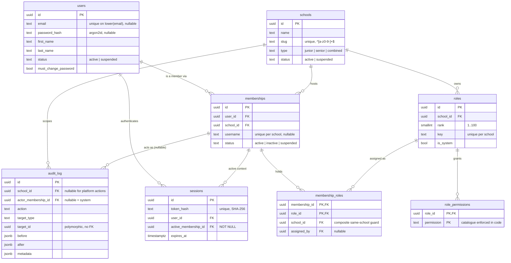
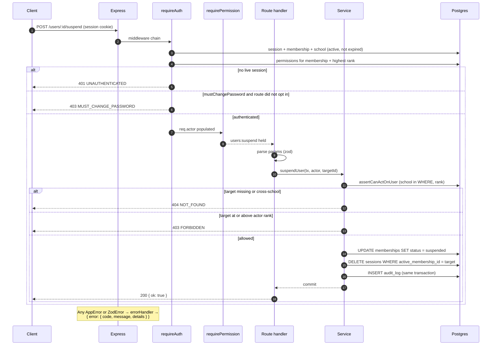

# Architecture

This document describes the system as it is implemented: how a request travels,
which layer owns which decision, how authority is modelled, how authentication
and sessions work, and what the client can expect when something goes wrong.

The "why" behind the larger choices is in [docs/decisions/](docs/decisions/);
the threats and their tests are in [SECURITY.md](SECURITY.md).

---

## The system in one paragraph

A single Postgres database holds many schools. A person is one row in `users`;
their relationship with a school is a row in `memberships`. Roles are per
school, permissions are granted to roles, and a membership holds roles. Every
school-scoped table carries `school_id` and participates in composite foreign
keys, so the database itself rejects a row that mixes tenants. Authentication
is a database-backed session carried in an `httpOnly` cookie; authorization is a
permission check at the route plus a rank check in the service. Every mutation
writes an audit row in the same transaction.

---

## Request journey

A request to `POST /users/:id/suspend` goes through the following stages. The
sequence diagram at the end of this section shows the same path.

1. **Transport.** Express parses the body (100 kB limit), reads the `session`
   cookie, applies CORS and helmet, and logs the request through pino-http with
   `cookie` and `authorization` headers removed.
2. **`requireAuth`.** Hashes the raw cookie token with SHA-256 and looks up a
   live session, joining the active membership and school. The query requires
   the session not to be expired and the user, membership, and school all to be
   `active`. It then loads the membership's permission set and highest role
   rank, and attaches `req.actor`, `req.sessionId`, and
   `req.mustChangePassword`. If `mustChangePassword` is set, the request is
   rejected with `403 MUST_CHANGE_PASSWORD` unless the route opted in.
3. **`requirePermission`.** Checks the permission against the actor's set. This
   middleware does not know the target yet, so it cannot check school scope.
4. **Route handler.** Validates the body/query with Zod (`.strict()`), extracts
   path parameters, and opens a transaction. The route owns HTTP concerns only:
   status code and response shape.
5. **Service.** Re-checks everything that depends on the target: the target
   exists in the actor's school, the actor outranks them, and the actor holds
   the capability. It performs the mutation, any session revocation, and the
   audit insert inside the same transaction.
6. **Repository.** Issues the SQL. School-scoped reads put `school_id` in the
   `WHERE` clause, so a cross-school ID is simply not found. Constraint
   violations that mean something to the client are translated to `AppError`
   here (e.g. duplicate username → `409 USERNAME_TAKEN`).
7. **Response.** The DTO is built and returned. Errors go to the single error
   handler, which maps `AppError` and `ZodError` to the documented envelope;
   anything else becomes a `500 INTERNAL_ERROR` and is logged.

A read-only endpoint such as `GET /users/:id` may call a repository directly
from the route, because there is no invariant to protect. Anything that mutates
state goes through a service and a transaction.

---

## Layer rules

| Layer          | Lives in                              | May do                                                                 | Must not do                                                    |
| -------------- | ------------------------------------- | ---------------------------------------------------------------------- | -------------------------------------------------------------- |
| Route          | `src/modules/*/routes.ts`             | Parse input, choose middleware, open a transaction, map DTOs, set status | Contain SQL, rank logic, or multi-step invariants               |
| Service        | `src/modules/*/service.ts`            | Enforce invariants, load targets, check rank/scope, audit, compose work | Touch `req`/`res` or know HTTP status codes as anything but `AppError` |
| Repository     | `src/modules/*/repository.ts`         | Query, join, paginate, put `school_id` in `WHERE`, translate DB errors  | Make authorization decisions                                   |
| Middleware     | `src/modules/*/middleware/`           | Authenticate, check a permission, rate limit, populate `req`             | Load targets or make business decisions                         |
| Domain (pure)  | `src/modules/rbac/can.ts`, `permissions.ts` | Rank/role/permission predicates with no I/O                        | Query the database                                             |
| Shared         | `src/shared/`                         | Errors, audit writer, pagination, password hashing, pg-error mapping     | Know about a specific module's rules                           |

Two rules carry most of the weight:

- **The school comes from the session, never from the request.** No endpoint
  accepts a `schoolId` body field or path parameter. Services take `actor` and
  use `actor.schoolId`.
- **Mutating work is transactional.** The mutation, its session revocation, and
  its audit row share one `db.transaction`. A failure anywhere rolls all of it
  back.

---

## Authority model

### Permissions

`src/modules/rbac/permissions.ts` is the source of truth. The format is
`resource:action`, plural resources for collections (`users`, `roles`) and
singular for the tenant itself (`school`, `audit`).

| Permission                 | Meaning                                          |
| -------------------------- | ------------------------------------------------ |
| `school:read`              | View school name, motto, contact details          |
| `school:update`            | Edit the school profile                           |
| `users:read`               | List and view members                             |
| `users:create`             | Invite/create a member                            |
| `users:update`             | Edit a member's profile                           |
| `users:suspend`            | Suspend and reactivate a member                   |
| `users:reset_password`     | Issue a replacement password                      |
| `roles:read`               | List roles                                        |
| `roles:assign`             | Grant or revoke a role                            |
| `roles:manage_permissions` | Change what a role can do                         |
| `audit:read`               | Read the school audit log                         |

The database does **not** know this list. `role_permissions.permission` is text;
the code validates input against the tuple, and a unit test asserts every
catalogue entry is granted to at least one default role.

### Roles

Every school gets its own copy of five system roles at creation. They can
diverge afterwards.

| Key         | Rank | Default permissions                                                                                   |
| ----------- | ---: | ----------------------------------------------------------------------------------------------------- |
| `owner`     |  100 | All 11. Permissions are locked; the role cannot be edited.                                            |
| `principal` |   80 | `school:read`, `users:*` (read/create/update/suspend/reset_password), `roles:read`, `roles:assign`, `audit:read` |
| `teacher`   |   50 | `school:read`                                                                                          |
| `guardian`  |   25 | `school:read`                                                                                          |
| `student`   |   20 | `school:read`                                                                                          |

A membership may hold several roles. Its effective permissions are the union;
its **rank is the maximum** among its roles (`loadMembershipRank`).

### Rank

Rank answers one question: *may this actor act on this person?* The rule is
strictly greater (`canManageMember`), so:

- an owner (100) can act on anyone in the school;
- a principal (80) can act on teachers, guardians, and students, but not on
  another principal or an owner;
- a teacher (50) cannot act on another teacher;
- an actor with no roles (rank 0) can act on nobody.

### Delegation

Granting a role is checked separately (`canAssignRole`):

```
role.rank < actor.rank  AND  role.permissions ⊆ actor.permissions
```

You cannot grant a role at or above your own rank, and you cannot grant a
capability you do not hold. The same subset rule applies when editing a role's
permissions, so permission editing cannot be used to build a role you could
then assign. The owner role is exempt because it is locked.

### Scope

There are two layers of scope:

1. **Row scope** — every school-scoped query includes `school_id = actor.schoolId`
   in the `WHERE`. A cross-school ID returns `404`, the same response as a
   random UUID. Nothing about another tenant's rows is observable.
2. **Resource scope (pure)** — `can(actor, permission, { schoolId })` also
   rejects a resource in another school. Used when the resource is already in
   memory; the SQL filter is the primary mechanism.

The composite foreign keys (ADR 0002) are the third layer: even a bug that
reaches the database with a mixed-tenant pair cannot commit.

---

## Authentication and sessions

### Login

`POST /auth/login` accepts `{ email, password, schoolSlug? }`.

1. Normalise the email and load the user.
2. Verify the password against the argon2id hash. If the user is unknown,
   verify against a fixed dummy hash instead, so the response time does not
   reveal whether the email exists.
3. Reject unless the user is `active` and has a password. All failure modes
   return the same `401 INVALID_CREDENTIALS` body.
4. Load active memberships, **also requiring an active user and an active
   school**. No memberships → generic 401.
5. Choose the active membership:
   - `schoolSlug` supplied → must match one of the memberships, else generic 401;
   - exactly one membership → use it;
   - more than one and no slug → return `{ kind: "select_school", schools }`
     **without creating a session**; the client asks again with a slug.
6. In one transaction: insert the session, update `last_login_at`, and write
   `auth.login_succeeded` to the audit log.
7. Set the `session` cookie and return IDs.

### Session

- Token: 32 random bytes, base64url. Only its SHA-256 hash is stored. A database
  leak does not yield usable tokens.
- Cookie: `httpOnly`, `sameSite=lax`, `secure` in production, `path=/`,
  configurable `COOKIE_DOMAIN`, TTL from `SESSION_TTL_DAYS`.
- `active_membership_id` is `NOT NULL` and composite-FK'd to
  `(memberships.id, memberships.user_id)`, so a session always has a school and
  can never point at someone else's membership.
- Validity is evaluated on every request: row exists, not expired, user active,
  membership active, school active. Suspension takes effect on the next request.

### Revocation

Deleting the row is the revocation (ADR 0003).

| Trigger                | What is deleted                                      |
| ---------------------- | ---------------------------------------------------- |
| Logout                 | the current session                                  |
| Password change        | every session of that user **except** the current one |
| Admin password reset   | every session of the target user                     |
| Membership suspension  | sessions whose `active_membership_id` is that row     |
| User deletion          | cascade via `sessions_user_fk`                       |

Not implemented yet: a `switch-school` endpoint (the login flow can select on
first login, but there is no in-session switch), "sign out everywhere" as its
own endpoint, forgot-password, and a job to reap expired session rows. See
[ROADMAP.md](ROADMAP.md).

### Multi-school accounts

One user row, many memberships. A teacher-parent is a single identity with two
memberships at one school; a teacher at two schools has two memberships at two
schools. Because a password change at School A would take over the identity at
School B, admin-initiated password reset and email change are refused for
multi-school users (`assertNoOtherSchoolMemberships` → `409 SHARED_ACCOUNT`).
They must use self-service once it exists.

---

## Error model

Every error response has the same envelope:

```json
{
  "error": {
    "code": "FORBIDDEN",
    "message": "You cannot assign this role",
    "details": "optional — validation paths or a human hint"
  }
}
```

| Status | Code                  | Raised when                                                     |
| -----: | --------------------- | --------------------------------------------------------------- |
| 400    | `VALIDATION_ERROR`    | Zod rejects a body, query, or parameter                          |
| 400    | `UNKNOWN_ROLE`        | One or more role keys do not exist at this school                |
| 400    | `INVALID_CURSOR`      | An audit cursor is malformed                                     |
| 400    | `SAME_PASSWORD`       | New password equals the current one                              |
| 400    | `NO_PASSWORD`         | The account has no password set                                  |
| 401    | `UNAUTHENTICATED`     | No session cookie, or the session is not live                    |
| 401    | `INVALID_CREDENTIALS` | Login failed, for any reason (deliberately undifferentiated)     |
| 401    | `INVALID_PASSWORD`    | The current password supplied for a change is wrong              |
| 403    | `FORBIDDEN`           | Missing permission, rank, or scope                               |
| 403    | `MUST_CHANGE_PASSWORD`| The flag is set and the route did not opt in                     |
| 404    | `NOT_FOUND`           | Unknown route, or a row that is not in the actor's school        |
| 409    | `ALREADY_MEMBER`      | The user already has a membership at this school                 |
| 409    | `USERNAME_TAKEN`      | The username is taken within this school                         |
| 409    | `SHARED_ACCOUNT`      | A multi-school user's identity would be changed by one school    |
| 429    | `RATE_LIMITED`        | More than 5 failed logins per IP in 15 minutes                   |
| 500    | `INTERNAL_ERROR`      | Unhandled error; logged with the request ID                      |
| 500    | `INTERNAL`            | A validated invariant was violated (e.g. a session points at a missing user); should be unreachable, logged as a server fault |

Two conventions keep status codes honest:

- **User-supplied IDs get a 404; internal invariants use `one()`.** `one()`
  throws a plain error when a `.returning()` or an invariant-backed lookup is
  empty, which surfaces as a 500. A row looked up by a request ID is
  destructured and checked, so a missing row is a 404, not a server fault.
- **Cross-school is indistinguishable from nonexistent.** The school appears in
  the `WHERE`, so both produce the same 404.

Success bodies are not as uniform as errors — deliberately, for now:
`{ ok: true }` for acknowledgements, `{ data, page }` for paginated lists,
`{ data, nextCursor }` for the audit log, domain objects for single resources,
and a discriminated union for login. Normalising these is a candidate for the
OpenAPI work rather than a reason to break clients today.

---

## API documentation

The OpenAPI 3.1 document is generated from the same Zod schemas the routes use;
there is no hand-written spec to drift.

- **One registry** — `src/openapi/registry.ts` calls `extendZodWithOpenApi(z)`
  once, registers shared components (`ErrorResponse`, `OkResponse`,
  `Pagination`), and declares the `session` cookie security scheme. Every
  module's `openapi.ts` imports it before importing schemas, so the extension
  is installed before any `.openapi(...)` call.
- **Schemas per module** — request schemas live in `src/modules/*/schema.ts` and
  are imported by both the route and the registration. Response schemas live in
  `src/modules/*/openapi.ts` next to `registry.registerPath(...)`. Each path
  description names the required permission and the rank/delegation rule.
- **Generation** — `src/openapi/document.ts` imports the module registrations
  for their side effects and memoizes `OpenApiGeneratorV31`. `generate.ts`
  writes the committed `docs/openapi.json` (`npm run docs:openapi`).
- **Serving** — `src/openapi/router.ts` serves `/openapi.json` and Swagger UI
  at `/docs`, mounted only when `isDocsEnabled()` is true. The flag defaults to
  on outside production and can be forced with `DOCS_ENABLED`.
- **CSP** — helmet's default policy blocks Swagger UI's inline bootstrap. A
  second helmet instance is mounted on `/docs` only, allowing inline scripts and
  styles and skipping `upgrade-insecure-requests`; all other routes keep the
  default policy.
- **Authentication in the UI** — cookie auth cannot be set by the Authorize
  button. Because `/docs` is same-origin with the API, calling
  `POST /auth/login` in Swagger UI sets the cookie for subsequent calls.
- **Tests** — `tests/integration/openapi.test.ts` asserts the document contains
  exactly the mounted paths and that the CSP relaxation is scoped correctly;
  `tests/integration/openapi-contract.test.ts` parses real responses with the
  documented schemas.

---

## Diagrams

### Entity relationships



`src/db/schema/students.ts` defines a 1:1 student profile keyed by
`membership_id`, but it is **not exported from `src/db/schema/index.ts`**, so
drizzle-kit does not see it and no `students` table exists yet. It is not part
of the current runtime model.

### Request flow


